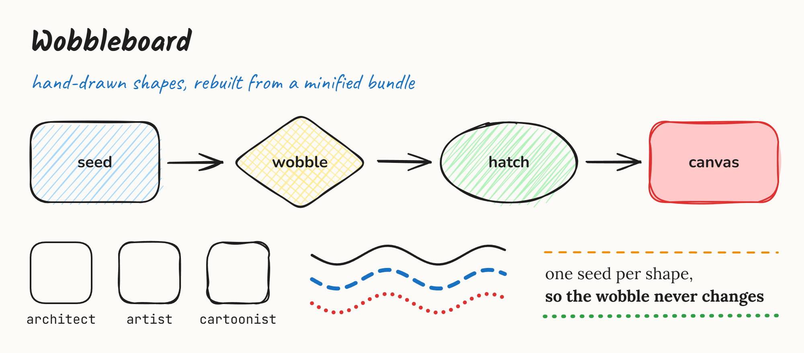

# Wobbleboard

<div align="center">
  
</div>

<div align="center">

[](https://github.com/allanryanbusiness-ship-it/wobbleboard/actions/workflows/ci.yml)
[](LICENSE)
[](https://allanryanbusiness-ship-it.github.io/wobbleboard/)

</div>

A hand-drawn whiteboard in 2,600 lines of dependency-free JavaScript. Its sketchy drawing engine was rebuilt from Excalidraw's minified production bundle, then proven byte-identical to the open-source originals.

<div align="center">
<h3>Try it</h3>

**[Open the live demo](https://allanryanbusiness-ship-it.github.io/wobbleboard/)**, or run it locally with one command:

```bash
npx github:allanryanbusiness-ship-it/wobbleboard
```

</div>

The image above is not a mock-up. It was drawn in Wobbleboard and saved with its own "Save PNG" button.

---

## TL;DR

**The Problem**: Excalidraw's hand-drawn look lives in three libraries and a 1.9 MB minified bundle. If you want to know how a shape gets its wobble, and why that wobble stays put every time the board repaints, there is no small place to read it.

**The Solution**: Wobbleboard is that small place. It is a working whiteboard whose whole drawing engine is four readable files, with every recovered line graded against the original it came from.

### Why Use Wobbleboard?

| Feature | What It Does |
|---------|--------------|
| **Readable engine** | Seeded wobble, hatching, pen outlines and text in 4 files and 1,634 lines. No framework. |
| **Graded, not guessed** | 3,200 of 3,200 shapes match roughjs 4.6.4 byte for byte. 600 of 600 pen strokes match perfect-freehand 1.2.0. |
| **Zero dependencies, no build** | `node tools/serve.mjs` is the whole setup. There is nothing to `npm install` to run it. |
| **Stable wobble** | Each shape keeps one random seed, so it looks the same on every repaint, reload and export. |
| **Free-standing text** | Five bundled open-source fonts, regular and bold, four sizes. Text is never glued to a shape. |
| **Dotted and dashed pen** | The pen honours stroke style. Excalidraw's pen ignores it. |
| **Private by default** | Drawings stay in your browser's local storage. The page makes no network requests beyond its own files. |
| **Tested end to end** | 27 unit checks covering 46,656 shape and style combinations, plus 103 checks driven through the live page. |

### Quick Example

Start it, then draw with the number keys:

```text
2   drag               a rectangle
4   Shift + drag       a perfect circle
5   drag               an arrow
7   drag               a pen stroke
8   click, type        text (Ctrl+Enter to finish)
1   drag a box         select everything the box touches
Ctrl+D                 duplicate, each copy with its own wobble
Ctrl+Z                 undo, one step per action
```

The claim "same seed, same wobble" is one you can run. Save this as `demo.mjs` in the repo root:

```js
import { ShapeCache, newElement } from "./src/shapes.mjs";

const box = { x: 0, y: 0, width: 160, height: 90, seed: 424242 };
const drawing = (props) => JSON.stringify(ShapeCache.generateElementShape(newElement("rectangle", props)).sets);

console.log(drawing(box) === drawing({ ...box }));               // true:  same seed, same drawing
console.log(drawing(box) === drawing({ ...box, seed: 424243 })); // false: new seed, new wobble
```

```bash
node demo.mjs
```

---

## Design Philosophy

**1. One seed per shape.** A shape stores a random 31-bit integer when it is created. Every wobble is drawn from a small generator started from that seed, so regenerating the shape always gives the same lines. "New wobble" simply swaps the seed.

**2. Replace, never mutate.** Every change swaps in a new elements array and new element objects. Old arrays double as undo snapshots, and a `WeakMap` cache keyed on the element object stays valid without any invalidation code.

**3. No dependencies and no build step.** The app is plain ES modules and a 2D canvas. The server is 34 lines of Node. What you read in `src/` is exactly what the browser runs.

**4. Graded against an answer key.** The engine was written from the minified bundle alone. Only afterwards was it compared with roughjs, perfect-freehand and Excalidraw's source, by scripts you can re-run.

**5. Honest about the gaps.** What was not recovered, and what was only found with the answer key's help, is written down in [REPORT.md](REPORT.md) and in [Limitations](#limitations).

---

## How Wobbleboard Compares

| | Wobbleboard | Excalidraw | roughjs + perfect-freehand |
|---|---|---|---|
| What it is | Small whiteboard and a readable engine | Full whiteboard product | Drawing libraries you wire up yourself |
| Runtime dependencies | ✅ None | Many | The two libraries |
| Build step | ✅ None | Yes | Depends on your app |
| Sketchy output | ✅ Byte-identical to roughjs 4.6.4 | ✅ Uses roughjs 4.6.4 | ✅ The originals |
| Pen with dashed or dotted style | ✅ Yes | ❌ Ignored for pen strokes | ❌ Not provided |
| Pan and zoom | ❌ No | ✅ Yes | You build it |
| Resize and rotate shapes | ❌ No | ✅ Yes | You build it |
| Collaboration, libraries, images | ❌ No | ✅ Yes | You build it |
| Text | Free-standing only | Free-standing or bound to shapes | You build it |
| Maintained for production use | ❌ No | ✅ Yes | ✅ Yes |

**When to use Wobbleboard:**
- You want to read how hand-drawn rendering works, start to finish, in one sitting
- You want a tiny offline sketchpad with nothing to install
- You want a worked example of rebuilding code from a minified bundle and proving the result

**When Wobbleboard might not be ideal:**
- You need a real whiteboard for daily work. Use [Excalidraw](https://excalidraw.com).
- You need the engine in a product. Install [roughjs](https://github.com/rough-stuff/rough) and [perfect-freehand](https://github.com/steveruizok/perfect-freehand), which are maintained.

---

## Installation

You need [Node.js](https://nodejs.org) 22 or newer for every local option. There are no packages to install.

### No install: the live demo

Open **https://allanryanbusiness-ship-it.github.io/wobbleboard/**. Your drawing is kept in that browser only.

### One command

```bash
npx github:allanryanbusiness-ship-it/wobbleboard
```

Then open http://127.0.0.1:4173. To use another port:

```bash
npx github:allanryanbusiness-ship-it/wobbleboard 8080
```

### From source

```bash
git clone https://github.com/allanryanbusiness-ship-it/wobbleboard.git
cd wobbleboard
node tools/serve.mjs
```

### Without git

Download the [ZIP of the main branch](https://github.com/allanryanbusiness-ship-it/wobbleboard/archive/refs/heads/main.zip), unzip it, and run the same command inside the folder:

```bash
node tools/serve.mjs
```

Opening `index.html` by double-click does not work, because browsers block ES modules on `file://` pages.

---

## Quick Start

1. Start the server with `node tools/serve.mjs` and open http://127.0.0.1:4173.
2. Press `2` and drag on the board to draw a rectangle.
3. With the rectangle still selected, pick a background colour and a fill in the left panel.
4. Press `8`, click anywhere, type a label, and press Ctrl+Enter.
5. Press `1` and drag the label wherever you want it. It moves on its own.
6. Click "New wobble" with the rectangle selected to give it a different seed.
7. Click "Save PNG" to download the drawing, cropped to its content at double size.

---

## Commands

### Terminal

| Command | What it does |
|---|---|
| `node tools/serve.mjs [port]` | Serve the app on `127.0.0.1`. The port defaults to 4173. |
| `npm start` | Same as `node tools/serve.mjs`. |
| `npm test` | Run the 27 unit checks. Needs no browser and no packages. |
| `npm run grade` | Install the answer-key packages and run all three graders. |
| `node tools/ctx.mjs <file> <regex> [before] [after] [max] [skip]` | Print text around a pattern in a minified file, with `line:column` positions. |

```bash
node tools/serve.mjs 8080          # serve on another port
npm test                           # 27 of 27 checks passed
npm run grade                      # 3200/3200, 600/600, 24/24
node tools/ctx.mjs bundle.js "imul\(48271" 80 200
```

### Keyboard and mouse

| Action | How |
|---|---|
| Pick a tool | `1` Select, `2` Rectangle, `3` Diamond, `4` Ellipse, `5` Arrow, `6` Line, `7` Pen, `8` Text |
| Square, circle, or a line snapped to 15° | Hold Shift while dragging |
| Write text | Text tool and click, or double-click with Select |
| Edit text | Double-click it. Enter adds a line. Esc, Ctrl+Enter or clicking away finishes. |
| Select several shapes | Drag a box across them, or Shift-click to add and remove |
| Select everything | Ctrl+A |
| Move | Drag a selected shape. The whole selection moves together. |
| Duplicate, delete | Ctrl+D, Del |
| Undo, redo | Ctrl+Z, Ctrl+Shift+Z or Ctrl+Y |
| Drop the selection | Esc |

A shape stays selected after you draw it, so a style choice restyles it straight away. Pen strokes are the exception. They are not left selected, so a style choice sets up your next stroke.

### Live page check

`tests/browser.mjs` drives the running page with pointer and key events and reads the result back from the saved board, the controls and the canvas pixels. Run it on an empty board, from the browser console:

```js
(await import("./tests/browser.mjs")).run().then(console.table)
```

It refuses to start if anything is drawn, because it deletes and clears.

---

## Configuration

There is no configuration file. The few things you can change are these:

| Setting | Where | Default |
|---|---|---|
| Port | First argument to `tools/serve.mjs` | `4173` |
| Saved board | Browser local storage, key `wobbleboard-scene` | Empty board |
| Undo depth | `HISTORY_LIMIT` in `src/app.mjs` | `200` steps |
| Colours, fonts, sizes offered | `CHOICES` in `src/app.mjs`, `FONTS` and `FONT_SIZES` in `src/text.mjs` | 5 colours, 5 fonts, 4 sizes |

To back up or move a drawing, copy the saved board from the browser console:

```js
copy(localStorage.getItem("wobbleboard-scene"))               // copy the board as JSON
localStorage.setItem("wobbleboard-scene", "<pasted JSON>")    // restore it, then reload
```

---

## Architecture

```
┌──────────────────────────────────────────────────────────────────┐
│  Pointer and keyboard input                     index.html        │
└──────────────────────────────────────────────────────────────────┘
                              │
                              ▼
┌──────────────────────────────────────────────────────────────────┐
│  src/app.mjs   (original interface code)                          │
│  state: elements[] · selection · style · undo / redo stacks       │
│  every change swaps in a new elements array                       │
└──────────────────────────────────────────────────────────────────┘
          │                                          │
          ▼                                          ▼
┌──────────────────────────────┐        ┌────────────────────────────┐
│  src/shapes.mjs              │        │  Browser local storage     │
│  per-element options         │        │  key: wobbleboard-scene    │
│  roughness adjustment        │        └────────────────────────────┘
│  WeakMap shape cache         │
└──────────────────────────────┘
     │              │              │
     ▼              ▼              ▼
┌───────────┐ ┌──────────────┐ ┌───────────┐
│ rough.mjs │ │ freehand.mjs │ │ text.mjs  │
│ seeded    │ │ pressure-    │ │ fonts,    │
│ lines,    │ │ shaped pen   │ │ measuring,│
│ ellipses, │ │ outline      │ │ drawing   │
│ hatching  │ │              │ │           │
└───────────┘ └──────────────┘ └───────────┘
     │              │              │
     └──────────────┼──────────────┘
                    ▼
┌──────────────────────────────────────────────────────────────────┐
│  Canvas 2D            on screen, and again at 2x for "Save PNG"   │
└──────────────────────────────────────────────────────────────────┘
```

| Path | Contents |
|---|---|
| `src/rough.mjs` | Sketchy shape generator: seeded randomness, wobbly lines, ellipses, hatching, canvas drawing |
| `src/freehand.mjs` | Pressure-shaped pen stroke outline |
| `src/shapes.mjs` | Per-element options, roughness adjustment, shape cache |
| `src/text.mjs` | Text sizes, fonts, measuring and drawing |
| `src/app.mjs`, `index.html` | The whiteboard interface. Original work, not traced from the bundle. |
| `fonts/` | Ten bundled font files and their licences |
| `tests/run.mjs` | Unit checks against a stand-in canvas, plus the local server |
| `tests/browser.mjs` | End-to-end check of the live page |
| `grading/` | Three scripts that compare the rebuild with its answer keys |
| `tools/serve.mjs`, `tools/ctx.mjs` | The static server, and the context printer used to cite the bundle |

---

## How It Was Rebuilt and Graded

Wobbleboard began as a test of [REA](https://github.com/morluto/rea), a reverse-engineering toolkit, pointed at excalidraw.com. The engine was written by reading the minified bundle, without the source maps and without opening Excalidraw's repository. The public source was used only afterwards, as the answer key.

| Check | Answer key | Result |
|---|---|---|
| Sketchy shape generator | roughjs 4.6.4 | 3,200 of 3,200 shapes byte-identical |
| Pen stroke outline | perfect-freehand 1.2.0 | 600 of 600 strokes byte-identical |
| Excalidraw's own layer | `excalidraw/excalidraw` master | 24 of 24 claims confirmed |

Re-run it yourself:

```bash
cd grading
npm install
node grade-rough.mjs
node grade-freehand.mjs
node grade-layer.mjs
```

The first grading run used the latest roughjs, 4.6.6, and scored 3,162 of 3,200. Excalidraw pins 4.6.4, and against that version the score is 3,200 of 3,200. The reading of the bundle was precise enough to tell the two versions apart.

The full account, including what REA could and could not do and what the blind pass got wrong, is in [REPORT.md](REPORT.md).

---

## Troubleshooting

### The page is blank after double-clicking `index.html`

The browser console shows a line like `Access to script at 'file:///.../src/app.mjs' from origin 'null' has been blocked by CORS policy`. Browsers do not load ES modules from `file://`. Serve the folder instead:

```bash
node tools/serve.mjs
```

### `Error: listen EADDRINUSE: address already in use 127.0.0.1:4173`

Something else is using the port, often another copy of the server. Pick a different port:

```bash
node tools/serve.mjs 8080
```

### My drawing is gone

The board is saved per browser and per address. `http://localhost:4173` and `http://127.0.0.1:4173` are different addresses to the browser, and each has its own board. Open the address you drew on. A private window or cleared site data also starts empty.

### `Cannot find package 'roughjs' imported from .../grading/grade-rough.mjs`

The graders need their answer-key packages, which the app itself does not:

```bash
cd grading
npm install
```

### `grade-layer.mjs` reports fewer than 24 of 24

That grader reads Excalidraw's `master` branch from GitHub. It needs a network connection, and it can drift when Excalidraw changes the code it checks. The two graders with pinned versions, `grade-rough.mjs` and `grade-freehand.mjs`, do not drift.

### Shapes are missing after I made the window smaller

They are still there, off the edge. The board does not pan or zoom, so make the window larger again to reach them.

---

## Limitations

### What Wobbleboard Doesn't Do

- **No pan or zoom.** The board is the size of the window.
- **No resizing or rotating.** A shape can be moved, restyled, duplicated and deleted, but not reshaped after it is drawn.
- **No collaboration, images or shape libraries.**
- **One board per browser address.** There are no files to open or save, apart from the PNG export.
- **Undo history is not saved.** It holds 200 steps and resets on reload.

### Known Limitations

| Capability | Current State |
|---|---|
| Arrowheads | ⚠️ A plain two-line head with guessed proportions. Excalidraw's arrowhead geometry was not traced. |
| SVG path parsing | ⚠️ Only the absolute `M L Q C Z` commands the app emits. No arcs. |
| Fonts | ⚠️ Latin characters only. Other scripts fall back to a system font. |
| Text | ⚠️ No wrapping, and never bound to a shape, by choice. |
| Text and interface code | ⚠️ Original work with no answer key, so it is tested but not graded. |
| Dark mode, elbow arrows, constant-width pen | ❌ Not attempted. |

---

## FAQ

### Why "Wobbleboard"?

Every shape has a wobble, and the interesting part of the project is how that wobble is made and why it holds still.

### Is my drawing private?

Yes. It is stored in your browser's local storage and nowhere else. The page loads only its own scripts and fonts and sends nothing anywhere. That is true for the live demo as well, which is the same static files served by GitHub Pages.

### Is this Excalidraw's code?

No file was copied. The engine was reimplemented from behaviour read in Excalidraw's minified bundle, and it reproduces the output of roughjs and perfect-freehand exactly. Those projects are MIT-licensed and are credited in [THIRD_PARTY_NOTICES.md](THIRD_PARTY_NOTICES.md).

### Can I use the engine in my own project?

The licence allows it. For anything real, install roughjs and perfect-freehand instead. They are maintained, and this rebuild exists to be read.

### What does "byte-identical" mean here?

Each grader generates random cases, runs them through this repo's code and through the original library, and compares the resulting drawing operations as JSON strings. A single differing digit in a single coordinate counts as a miss.

### Does it work offline?

Yes. Once the files are on your machine there is nothing to download, fonts included.

### Why is there no build step?

So that the code you read is the code that runs. The whole app is five modules and one HTML file.

---

## About Contributions

> *About Contributions:* Please don't take this the wrong way, but I do not accept outside contributions for any of my projects. I simply don't have the mental bandwidth to review anything, and it's my name on the thing, so I'm responsible for any problems it causes; thus, the risk-reward is highly asymmetric from my perspective. I'd also have to worry about other "stakeholders," which seems unwise for tools I mostly make for myself for free. Feel free to submit issues, and even PRs if you want to illustrate a proposed fix, but know I won't merge them directly. Instead, I'll have an AI coding assistant review submissions via `gh` and independently decide whether and how to address them. Bug reports in particular are welcome. Sorry if this offends, but I want to avoid wasted time and hurt feelings. I understand this isn't in sync with the prevailing open-source ethos that seeks community contributions, but it's the only way I can move at this velocity and keep my sanity.

---

## License

MIT. See [LICENSE](LICENSE).

Excalidraw, roughjs and perfect-freehand are MIT-licensed, and the bundled fonts are under the SIL Open Font License. Their notices are in [THIRD_PARTY_NOTICES.md](THIRD_PARTY_NOTICES.md).
